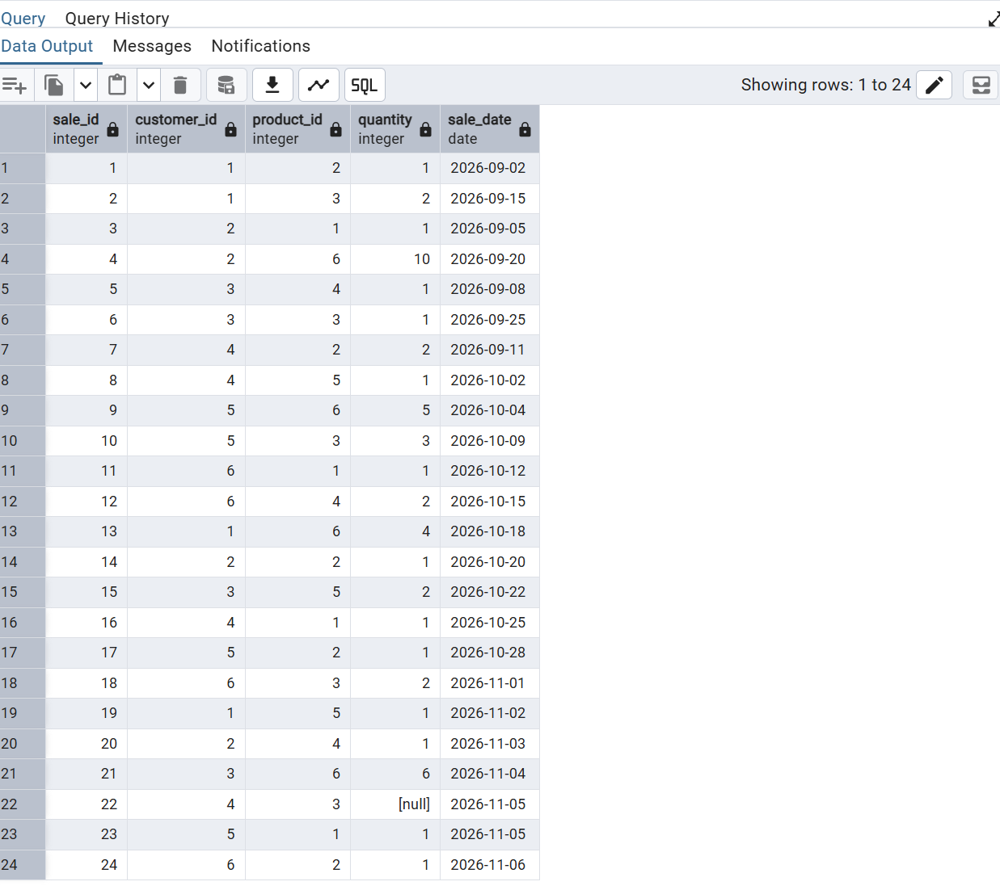
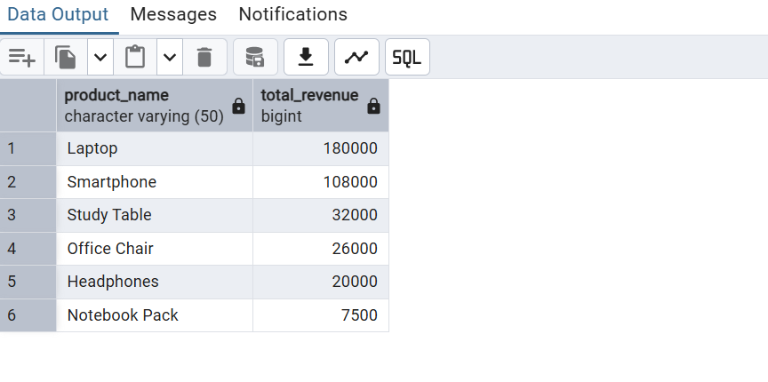
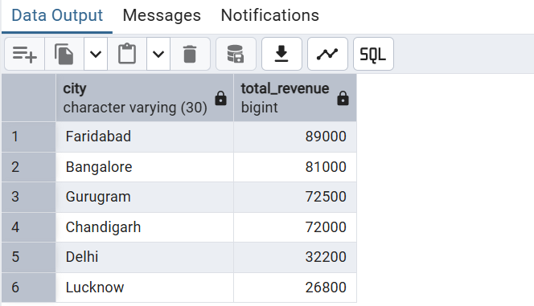

# 📊 Sales Analysis using SQL

## 📌 Project Overview
This project analyzes sales data using PostgreSQL to generate business insights about products, customers, cities and revenue trends. I built a relational database with three tables and answered 10 business questions using SQL.

## 🛠 Tools Used
- PostgreSQL
- pgAdmin 4

## 🗂 Database Schema
The database contains 3 tables:
- **customers**: customer_id, customer_name, city
- **products**: product_id, product_name, category, price
- **sales**: sale_id, customer_id, product_id, quantity, sale_date

`sales` is linked to `customers` and `products` through customer_id and product_id.

## 🧠 SQL Concepts Used
SELECT, WHERE, ORDER BY, COUNT, SUM, GROUP BY, HAVING, NULL handling, JOINs, TO_CHAR

## ❓ Business Questions Answered
1. Which products cost more than 5000?
2. How many sales were made and what is the total quantity sold?
3. How many units of each product were sold?
4. Which products sold more than 5 units?
5. Which customers bought more than 3 units in October 2026?
6. How much revenue did each product generate?
7. Which sales have a missing quantity?
8. Which city generated the most revenue?
9. Which category earns the most?
10. What is the monthly revenue?

## 💡 Key Insights
- Total revenue is 373,500, and Electronics contributes 308,000 of it (about 82%).
- Laptop is the top revenue product (180,000), while Notebook Pack sells the most units (25) but earns the least (7,500).
- Faridabad is the highest revenue city (89,000), followed by Bangalore (81,000).
- One sale has a NULL quantity, handled using IS NULL.

## 📸 Sample Output

## 📁 Files
- `sales_analysis.sql`: table setup and all 10 queries
- PNG files: output screenshot of every query

## 🎯 Project Outcome
Built a relational database and performed end-to-end sales analysis using SQL, including JOINs, aggregations and NULL handling.
